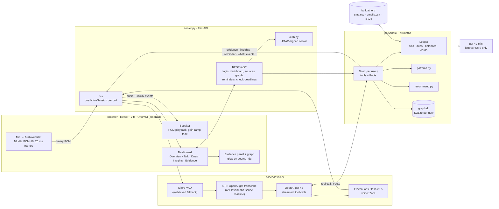
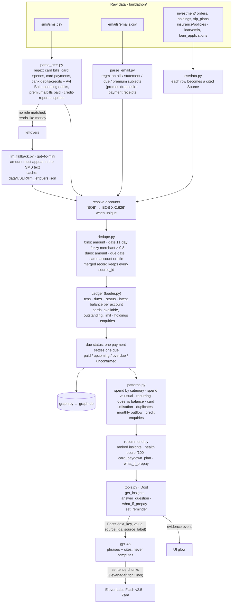
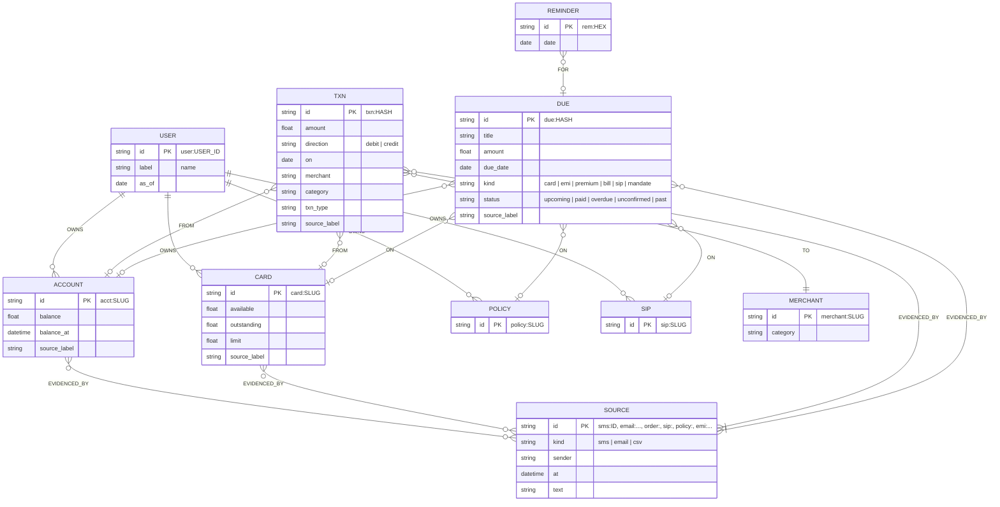
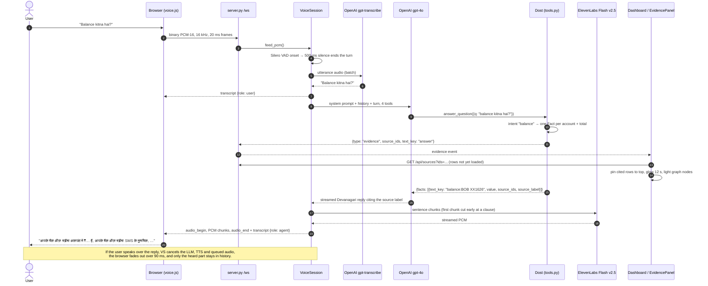
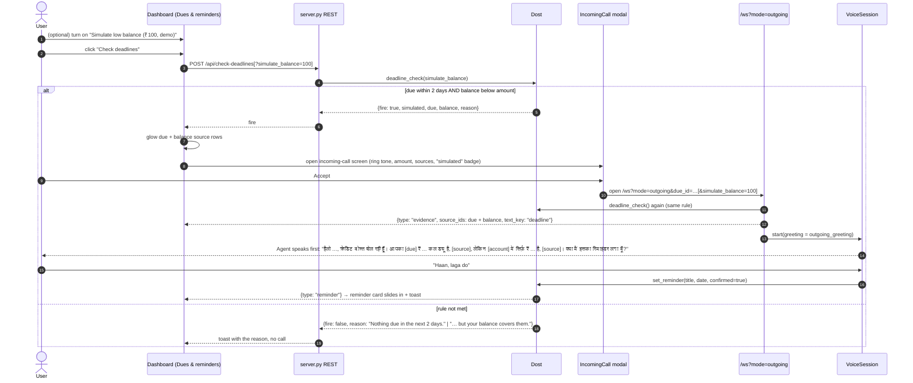

# Credit Dost

**A voice money friend that speaks Hindi, Hinglish and English and shows its proof.** Ask "Balance kitna hai?" and Credit Dost answers in one or two short spoken sentences. It names the SMS or email behind every number, and the matching evidence row lights up on screen while it speaks.

Built for the **Voice AI x Finance buildathon**.

| | |
|---|---|
| **Voice** | Full-duplex call in the browser. Silero VAD, OpenAI `gpt-transcribe` STT, OpenAI `gpt-4o` with tools, ElevenLabs Flash v2.5 TTS ("Zara" voice). The user can interrupt at any time. |
| **Data** | A user's raw SMS, emails and CSV records, parsed by regex into one deduplicated ledger. An LLM fallback reads only the leftover SMS that no regex matched. |
| **Rule** | The LLM never does maths. Every number comes from a tool as a `Fact {text_key, value, source_ids, source_label}`, and the agent cites the source after each number. |
| **UI** | React + Vite on the AtomUI design system (emerald pigment). It has a live transcript, an evidence panel that glows, a force-directed money graph, a health ring, insights, dues, reminders and a simulated incoming call. |

---

## Contents

1. [The problem and our proposed solution](#the-problem-and-our-proposed-solution)
2. [Features](#features)
3. [Architecture](#architecture)
4. [Data pipeline](#data-pipeline)
5. [Graph schema](#graph-schema)
6. [One voice question, end to end](#one-voice-question-end-to-end)
7. [The outgoing deadline call](#the-outgoing-deadline-call)
8. [Voice tools](#voice-tools)
9. [Insights, health score and the paydown plan](#insights-health-score-and-the-paydown-plan)
10. [API](#api)
11. [The UI](#the-ui)
12. [Voice layer (cascadevoice)](#voice-layer-cascadevoice)
13. [Setup and run](#setup-and-run)
14. [Done-when checklist](#done-when-checklist)
15. [Known limitations](#known-limitations)
16. [Project structure](#project-structure)

---

## The problem and our proposed solution

**Problem.** An Indian user's financial picture is spread across thousands of bank SMS, card statement emails, autopay notices, SIP and insurance records. No single place says "your card bill is due tomorrow and your account can't cover it". Chat assistants that try to help often make up numbers.

**Our proposed solution.** Credit Dost treats the user's own messages as the source of truth. It answers out loud, in the user's language, and never states a number it cannot point to.

1. **Parse everything with plain code.** Regex parsers turn SMS and emails into transactions, balances, card observations and dues. CSV rows (SIPs, policies, orders, EMIs) are read directly. Only SMS that no regex understood go to `gpt-4o-mini`. Its amounts are thrown away unless they appear verbatim in the SMS.
2. **Merge the same money event across channels.** A bank SMS and a merchant receipt email for one payment become one fact that keeps both source ids.
3. **Compute every pattern, insight and score in Python.** This covers spend by category, spend vs usual, recurring charges, dues vs balance, card utilisation, duplicate charges, credit-report enquiries, a health score out of 100, and an avalanche card paydown plan.
4. **Let the LLM phrase, not calculate.** `gpt-4o` gets four tools. Each returns finished `Fact`s carrying `source_ids` and a spoken `source_label`. The system prompt forbids any number not taken from a tool, requires a citation after every number, and caps replies at two short sentences.
5. **Show the proof live.** Whenever a tool returns facts, the server pushes an `evidence` event. The UI pins those SMS/email rows to the top of the evidence panel and makes them glow, and lights up the matching graph nodes.
6. **Act, carefully.** The agent sets reminders only after a spoken "yes". It "calls" the user first (a simulated incoming call) only when a due is at most 2 days away **and** the paying balance is below the amount.

---

## Features

| Feature | What it does | Where |
|---|---|---|
| Trilingual voice call | Hindi, Hinglish or English. The reply follows the user's language. Hindi replies are written in **Devanagari** so the TTS accent is right, and the persona uses feminine Hindi forms ("मैं देख रही हूँ"). | `paisadost/tools.py` `SYSTEM_PROMPT`, `cascadevoice/` |
| Cited answers | Every number carries `source_ids` and a label such as "from your Bank of Baroda SMS on 25 Sep". The agent says it after the number. | `tools.py` `fact()`, `models.Source.label` |
| Barge-in | Interrupting mid-sentence stops the TTS. The history keeps only what the user actually heard, and the agent answers the new question. | `cascadevoice/session.py` |
| Live evidence glow | Cited rows pin to the top of the Evidence panel and glow for 12 s. Graph nodes light up too. | `EvidencePanel.jsx`, `GraphView.jsx`, `Dashboard.jsx` (`GLOW_MS`) |
| Money graph | A force-directed graph (d3-force physics, hand-drawn SVG) of User → accounts/cards → txns/dues → merchants and sources, stored per user in SQLite. | `paisadost/graph.py`, `GraphView.jsx` |
| Ranked insights | One line per pattern, ranked by rupee impact. Late dues always come first. | `paisadost/recommend.py` `insights()` |
| Credit insight | Which card to pay first and the monthly interest it costs, plus a warning when the credit report was checked 3 or more times in 90 days (from CIBIL/Experian/CRIF "report checked by" SMS). | `recommend.py`, `parse_sms.enquiry()` |
| What-if prepay | "Agar 20 hazaar prepay karun?" returns pay per card, utilisation before → after, and interest saved per month. A what-if card appears in the UI. | `recommend.what_if_prepay()`, `card_paydown_plan()` |
| Money health score /100 | Five parts, each with its own sources. Clicking a part shows its evidence. | `recommend.health_score()`, `HealthRing.jsx` |
| Voice reminders | `set_reminder` needs a spoken confirmation. A reminder card then slides in and is saved per user and linked to its due in the graph. | `tools.Dost.set_reminder()`, `Panels.jsx` `Reminders` |
| Outgoing deadline call | "Check deadlines" fires an incoming-call screen (with a ring tone) only under the 2-day / low-balance rule. The agent speaks first with the alert and its sources. | `tools.Dost.deadline_check()`, `outgoing_greeting()`, `IncomingCall.jsx` |
| Simulate low balance | A clearly labelled demo switch, "Simulate low balance (₹100, demo)". No real user meets the call rule, so it lets the call fire. The rule itself is unchanged, and the call screen shows a "simulated" badge. | `Dashboard.jsx`, `?simulate_balance=100` |
| Text fallback | A live transcript is always on screen, with a text box you can type into during a call instead of speaking. | `Transcript.jsx`, `user_text` WS message |
| Basic auth + personas | Sign in with any of the 24 dataset emails and the shared `DEMO_PASSWORD`, using an HMAC-signed cookie. A sidebar switcher moves between 7 demo personas. | `paisadost/auth.py`, `server.py` `PERSONAS` |
| Mock mode | `?mock=1`, or an unreachable backend, makes the UI run on mock data with a simulated call. The UI shows a "Mock mode" badge. | `frontend/src/lib/api.js`, `mock*.js` |

---

## Architecture



* **One `Dost` per user** (`paisadost/tools.py`) holds the ledger, the patterns, the graph and the reminders, and is cached in-process. At startup, `server.py` warms the cache for every demo persona.
* The ledger is pickled to `data/<user>/ledger-v7-<AS_OF>.pkl`, so the dataset is parsed once per user.
* The WebSocket gives the `Dost` a `notify` callback. Tools push UI events (`evidence`, `insights`, `reminder`, `whatif`) down the same socket as the audio.

---

## Data pipeline



**Key rules in the pipeline:**

* **Regex first.** `parse_sms.parse()` returns `(records, understood)`. An SMS with money words but no matching rule is a *leftover*. Promotional SMS (offers, "pre-approved", "eligible for"…) are filtered out.
* **LLM only for leftovers** (`llm_fallback.py`):
  * `gpt-4o-mini` at temperature 0, in batches of 25.
  * Labels each SMS as `txn`, `due` or `none`.
  * An amount the model returns is kept only if those digits appear in the SMS. Disbursal, authorise and "initiated" messages are dropped.
  * The citation is marked "(read by AI)".
  * Turn it off with `PAISA_LLM_FALLBACK=0`.
* **Dedupe** (`dedupe.py`):
  * Same direction and amount, dates within ±1 day, and fuzzy merchant similarity ≥ 0.8 (or the same account).
  * Two rows of one CSV are never merged. Two SMS from the same sender merge only if they are resends a few minutes apart.
  * Example: a ₹101 Bank of Baroda SMS debit and the Razorpay receipt email for it become **one** transaction with **2 source ids**.
* **Due status** (`loader._due_status`):
  * A due counts as paid when a matching debit lands between 20 days before and 5 days after its due date. The amount must be within 1% and the card/account or name must match.
  * Each payment settles only one due.
  * An unpaid due is `overdue` only if it fell due within the last 30 days. Older ones are `unconfirmed`, because the payment may be in a channel we can't see.
* **Card limits** are derived as `available + outstanding` when both are known from the user's messages.

---

## Graph schema

Each user has one SQLite database at `data/<user_id>/graph.db`, with tables `nodes(id, type, label, props)` and `edges(src, dst, rel, props)`. Facts link to their proof through `EVIDENCED_BY` edges. So "how do you know?" is a one-hop query, and the UI can light up the path from a spoken number to the SMS behind it.



`/api/graph` returns every non-transaction node, the 120 most recent `Txn` nodes, and the `Source` nodes they point to.

---

## One voice question, end to end

"Balance kitna hai?", from the mic to a cited answer with the evidence glow:



---

## The outgoing deadline call

The rule (`Dost.deadline_check`) fires only if an **upcoming due is 0 to 2 days from `AS_OF`** and **the balance that pays it is below the amount**. The paying balance is the due's own account, or else the largest bank balance. No real user in the dataset meets this rule. The demo uses the labelled "Simulate low balance (₹100)" switch, which replaces only the balance; the rule stays the same.



---

## Voice tools

The four tools are registered in `Dost.tools()` (`paisadost/tools.py`). Each returns `Fact`s, and none lets the LLM do arithmetic. `cascadevoice` adds a fifth, built-in `end_call` tool.

| Tool | Arguments | Returns | UI event |
|---|---|---|---|
| `get_insights` | none | Top 3 ranked insights as Facts, plus the health score Fact | `insights`, `evidence` |
| `answer_question` | `q`: the user's words, verbatim | Up to 8 Facts. Keyword intents (English, Hinglish and Devanagari) pick: **balance** (per account + total), **dues**, **spend** (30-day total, top categories, vs usual), **card** (utilisation, credit insights, a note that the CIBIL score number isn't available), **recurring**, **invest** (SIPs, holdings), **health**, **duplicate**, **recent**, or a named **merchant**. No intent → balances + dues. No facts → "say you don't see it; do not guess". | `evidence` |
| `what_if_prepay` | `amount` (₹) | Amount used vs left over, interest saved per month (citing "the card issuer's published finance charge"), utilisation before → after, pay per card | `whatif`, `evidence` |
| `set_reminder` | `title`, `date` (YYYY-MM-DD), `confirmed` | Without `confirmed=true`: `not_set` and a read-back for the user to confirm. With it: saves to `data/<user>/reminders.json`, adds a `Reminder` node linked `FOR` its matching due | `reminder` |

**System prompt rules** (`SYSTEM_PROMPT` in `tools.py`):

* Numbers only from tool results; never calculate, estimate or invent.
* Never say a number without its source; at most 2 items per reply, each cited.
* At most 2 short sentences, no markdown, lists or emojis.
* Hindi/Hinglish in → Devanagari out (including the translated source label). English in → English out.
* Whole rupees only.
* Read back and ask "Shall I set it?" before `set_reminder`, and pass `confirmed=true` only after a clear yes ("haan", "kar do", "theek hai").
* If interrupted, stop and answer the new question.

**Session start:**

* The greeting is generated in code from the top-ranked insight and its source, in Devanagari, and offers a reminder.
* The server pushes the top 3 insights to the UI as the call opens.

---

## Insights, health score and the paydown plan

All in `paisadost/recommend.py`, on top of `paisadost/patterns.py`.

### Insights (ranked by rupee impact; late dues always first)

| Kind | Trigger | Says |
|---|---|---|
| `due` / `upcoming` | Unpaid due within 7 days or up to 30 days late | Amount, how late or how soon, and the shortfall if the paying balance is short |
| `credit` (pay first) | Any card with a known unpaid bill | Which card to pay first (highest APR), and the monthly interest if the bill is carried |
| `credit` (enquiries) | ≥ 3 credit-report checks in 90 days (CIBIL / Experian / CRIF SMS) | Number of checks and lenders; pause new applications |
| `recurring` | Same payee, near-equal amount, ≥ 3 times on a daily/weekly/monthly rhythm, ≥ ₹500/month | Monthly cost; check every plan is still wanted |
| `duplicate` | Same payee and amount twice on the same day (bank/email txns, ≥ ₹50) | Possible double charge; ask for a refund |
| `spend` | A category > ₹1,000 above its usual 30-day average | Last 30 days vs usual |

### Money health score /100

| Part | Max | How it's scored |
|---|---|---|
| Bills on time | 25 | −8 per overdue due in the last 60 days |
| Cash buffer | 25 | Bank balance ÷ monthly outflow; 3 months = full marks |
| Credit use | 20 | Utilisation of known limits: ≤10% → 20, ≤30% → 16, ≤50% → 8, else 2. No limit known → 10 (midpoint) |
| Investing habit | 15 | Recurring investment debits as a share of outflow; 20% = full marks |
| Steady spending | 15 | −5 per category well above usual |

Grade: **Strong** ≥ 75, **Fair** ≥ 55, otherwise **Needs attention**. Missing data scores the midpoint, never full marks.

### `card_paydown_plan(cards, cash)`

This is an avalanche plan by APR:

1. **Pass 1:** bring each card under **30%** utilisation, highest APR first.
2. **Pass 2:** clear the remaining balances in APR order.

It returns the payment per card, the new outstanding, utilisation before and after, and interest saved per month (`pay × APR / 12`). `what_if_prepay` reuses it, and also reports utilisation across every card with a known limit and the bank balance before and after.

**Card APRs** are the issuers' published finance-charge rates (`CARD_APR_PCT`). The data has no APR because the statements are password-protected. Any fact that uses them says so.

---

## API

FastAPI on `http://127.0.0.1:8000`. Every route except `/api/login` needs the `pd_session` cookie and returns 401 without it. The full contract is in [`API.md`](API.md).

| Method | Path | Purpose |
|---|---|---|
| `POST` | `/api/login` | `{email, password}` → `{user}` and sets the signed cookie (12 h) |
| `POST` | `/api/logout` | Clears the cookie |
| `GET` | `/api/me` | Current user |
| `GET` | `/api/demo-users` | The 7 demo personas with their tags |
| `POST` | `/api/switch-user` | `{user_id}`: switch to a persona (re-signs the cookie) |
| `GET` | `/api/dashboard` | `as_of`, `health`, top 3 `insights`, upcoming `dues`, `balances`, `reminders` |
| `GET` | `/api/insights` | Every ranked insight |
| `GET` | `/api/sources?ids=a,b` | Source rows (SMS/email/CSV text and citation label) for the evidence panel |
| `GET` | `/api/graph` | `{nodes, links}` for the graph view |
| `GET` | `/api/reminders` | Saved reminders |
| `POST` | `/api/check-deadlines[?simulate_balance=N]` | `{fire, simulated?, due?, balance?, reason}` |
| `WS` | `/ws` | Inbound call |
| `WS` | `/ws?mode=outgoing&due_id=…[&simulate_balance=N]` | Outgoing call: the agent speaks first with the alert |

**WebSocket messages:**

| Direction | Message |
|---|---|
| Client → server | Binary PCM-16 mono 16 kHz 20 ms frames · `{"type":"user_text","text"}` · `{"type":"interrupt"}` |
| Server → client (voice) | `connected` · `status` (idle/listening/transcribing/thinking/speaking) · `transcript` · `turn_complete` · `metrics` · `audio_begin`, binary PCM, `audio_end` · `control` (stop_playback/hangup) · `error` |
| Server → client (Credit Dost) | `evidence {source_ids, text_key}` · `insights {insights}` · `reminder {reminder}` · `whatif {result}` |

---

## The UI

React 18 + Vite, built on the **AtomUI** design system with the **emerald** pigment (`frontend/src/atom/`). It replaces the Tailwind + shadcn stack in the original brief, because AtomUI doesn't allow either.

| Page (sidebar) | What's on it |
|---|---|
| **Overview** | Health ring (counts up, click a part for its evidence), bank balances, top insights, next dues, "Talk now" |
| **Talk** | The call orb with status (idle/listening/thinking), Start call / Hang up / Stop talking, "Try saying" hints, the live transcript with a type-instead box, the what-if card, and a compact Evidence/Graph panel |
| **Dues & reminders** | The deadline check card with the "Simulate low balance (₹100, demo)" switch and **Check deadlines**, the dues list, and reminder cards (new ones slide in) |
| **Insights** | Every ranked insight, each with "show sources" |
| **Evidence** | Two tabs. **Evidence:** every source row (SMS / Email / Statement) with sender, date, text, citation label and source id. **Graph:** the force-directed money graph with zoom and reset |

**How the evidence glow works:**

* Each `evidence` event fetches any missing rows through `/api/sources`.
* The cited rows move to the top under "Cited just now · N sources" and glow for 12 s. Matching graph nodes light up.
* A pulsing dot on the Evidence nav item and tab shows there's something new to look at.

**Also in the UI:**

* An incoming-call modal with a WebAudio ring tone.
* A custom spring cursor that turns off on touch devices and with `prefers-reduced-motion`.
* Staggered reveal animations.
* A sidebar persona switcher.

---

## Voice layer (cascadevoice)

This is the existing full-duplex voice layer, reused unchanged except for its configuration in `cascadevoice/defaults.py`. Credit Dost plugs into it through `VoiceSession(transport, system_prompt, greeting, tools=[Tool(...)])`.

| Stage | Choice | Notes |
|---|---|---|
| Capture | AudioWorklet → 16 kHz PCM-16, 20 ms frames | The Safari fixes are ported from `web/index.html` into `frontend/src/lib/voice.js` |
| VAD | Silero (ONNX, `models/silero_vad.onnx`) | webrtcvad is the fallback. An adaptive noise floor and speaker focus ignore background voices |
| End of turn | `EOU_SILENCE_MS = 500` | |
| STT | **OpenAI `gpt-transcribe`** (batch, `STT_PROVIDER = "openai"`) | Chosen after a benchmark against `gpt-4o-transcribe`, `gpt-4o-mini-transcribe` and `whisper-1`; it was the most accurate on Hindi, Hinglish and noisy clips. **ElevenLabs Scribe realtime** (with batch Scribe fallback) is one switch away: `STT_PROVIDER = "scribe"` |
| LLM | **OpenAI `gpt-4o`**, streamed, temperature 0.3 | Up to 3 tool rounds per turn; the last 8 exchanges of history |
| TTS | **ElevenLabs Flash v2.5** (`eleven_flash_v2_5`), voice **Zara** | Sentence-chunked streaming. The first chunk is cut at a clause once it reaches 28 characters. Fixed lines (greetings) are cached |
| Barge-in | Speech sustained 450 ms over the agent, or a transcript that reads as a real interruption | Backchannels ("haan", "hmm") don't interrupt. On barge-in, the LLM, TTS and queued audio are cancelled, the client fades out over 90 ms, and history keeps only the heard sentences |
| Language | Follows the words the user speaks | Devanagari or Hinglish switches it |

`scripts/latency_harness.py` measures what the pipeline itself adds, using stub vendors (no keys needed).

---

## Setup and run

**Requirements:** Python ≥ 3.11, Node 18+, an OpenAI key and an ElevenLabs key.

```bash
# 1. Python env
python3 -m venv .venv
source .venv/bin/activate
pip install -e ".[dev]"

# 2. Dataset: put the buildathon folder at ./buildathon
#    (buildathon/sms/sms.csv, buildathon/emails/emails.csv, buildathon/emails/users_data.csv,
#     buildathon/investment/, buildathon/insurance/, buildathon/loan/)

# 3. Keys: create .env at the project root (see .env.example)

# 4. Frontend
cd frontend && npm install && npm run build && cd ..

# 5. Run
python server.py          # → open http://127.0.0.1:8000

# Tests
python -m pytest
```

### `.env`

| Key | Required | Meaning |
|---|---|---|
| `OPENAI_API_KEY` | yes | STT (`gpt-transcribe`), LLM (`gpt-4o`), leftover-SMS fallback (`gpt-4o-mini`). The server refuses to start without it |
| `ELEVENLABS_API_KEY` | yes | TTS (Flash v2.5), and Scribe if selected. The server refuses to start without it |
| `DEMO_PASSWORD` | yes | The shared password for all 24 dataset emails (default `paisadost`) |
| `SESSION_SECRET` | yes | HMAC key for the session cookie. If it's unset, a random one is generated per run, so everyone is logged out on restart |
| `AS_OF` | yes | "Today" for the data. Use `2026-10-16`, because the snapshot ends on 16 Oct 2026 |
| `PAISA_DATA_DIR` | optional | Dataset location (default `./buildathon`) |
| `PAISA_LLM_FALLBACK` | optional | `1` (default) labels leftover SMS with `gpt-4o-mini`; `0` turns it off |

`PAISA_STORE_DIR` (default `./data`) and `DEMO_USER` can also be overridden.

### Signing in

* Use any email from `buildathon/emails/users_data.csv` with `DEMO_PASSWORD`.
* The demo user is **Lokesh Verma** (`1749913629362473`), who has the richest data.
* After you sign in, the sidebar's **Demo user** switcher moves between the 7 personas:

| User id | Persona tag |
|---|---|
| `1749913629362473` | Overdue bills, 7 cards (Lokesh Verma) |
| `1747824302191779` | Stressed, overdue EMIs |
| `1748108541385190` | Double charges |
| `1750426955233987` | Healthy saver |
| `1750577443897920` | SIP investor |
| `1750389254784005` | Near-zero balance |
| `1750471929369018` | Many credit checks |

### Dev mode

* Run `cd frontend && npm run dev` to serve on `:5173`, which proxies `/api` and `/ws` to `:8000`.
* Add `?mock=1` to the URL to run the UI entirely on mock data with a simulated call.
* If `frontend/dist` doesn't exist, `server.py` falls back to the original voice console at `web/index.html`.

### `pyproject.toml`

* It already lists every runtime dependency the finance layer uses (`openai`, `numpy`, `fastapi`, `uvicorn`, `pydantic`, …). `paisadost` needs nothing beyond the standard library and `openai`.
* `[tool.setuptools.packages.find]` only includes `cascadevoice*`, so `paisadost` isn't installed as a package. It imports fine when you run from the project root (as `server.py` and `pytest` do).
* The project metadata still uses the name `cascadevoice`.

---

## Done-when checklist

Run `python -m pytest tests/test_paisadost.py -v`. The tests run on the real dataset and are skipped if `buildathon/` is missing.

| # | context.md check | How it's met | Test |
|---|---|---|---|
| 1 | `get_insights` returns ≥3 ranked insights, each with `source_ids` | `recommend.insights()` ranks by `impact_inr`, late dues first, and every `Insight` carries `source_ids` + `source_label` | `test_1_get_insights_ranked_with_sources` |
| 2 | "Balance kitna hai?" returns balance with a source label | The `balance` intent regex matches Hinglish and Devanagari. One Fact per account, cited "from your … SMS on …" | `test_2_balance_with_source_label` |
| 3 | Interrupting mid-sentence stops the agent and it answers the new question | cascadevoice barge-in (`BARGE_IN_HARD_MS = 450`), cancel + heard-only history, plus a "Stop talking" button (`interrupt`) | `test_3_barge_in_is_built_in`; behaviour covered in `tests/test_session.py` (e.g. `test_sustained_speech_over_the_agent_interrupts`, `test_a_cut_reply_is_recorded_only_as_far_as_it_was_heard`) |
| 4 | "Agar 20 hazaar prepay karun?" returns new utilisation and interest saved | `what_if_prepay` → `card_paydown_plan` (avalanche by APR, 30% target) → `whatif:util` and `whatif:saved` Facts + a what-if card | `test_4_what_if_prepay_returns_utilisation_and_interest` |
| 5 | "Reminder laga do" shows a reminder card after voice confirm | `set_reminder` returns `not_set` until `confirmed=true`; then it saves and pushes a `reminder` event → the card slides in | `test_5_reminder_needs_confirmation_then_creates_card` |
| 6 | A duplicate across SMS and statement merges into one fact with 2 source ids | `dedupe.merge_txns` on amount · date ±1 day · fuzzy merchant; e.g. the ₹101 Bank of Baroda SMS + Razorpay email → one txn, 2 source ids | `test_6_duplicate_across_sms_and_email_merges` |
| 7 | Outgoing call fires only when due ≤2 days and balance < amount | `Dost.deadline_check`: no fire on real data; fires with a simulated low balance; no fire with a huge balance | `test_7_outgoing_call_rule` |

All 7 pass on the current dataset. The full suite (`python -m pytest`) also runs the voice-layer tests offline, with no keys needed.

---

## Known limitations

* **No CIBIL score number.** Password-protected PDF attachments (Experian reports, bank and card statements) are **not opened**. Credit insights come from card SMS (available limit, statement dues) and the CIBIL/Experian/CRIF "report checked by" enquiry alerts. Asked for the score, the agent says it isn't in the messages.
* **Card APRs are published rates**, not the user's actual rate (they aren't in the data). Interest-saved figures say so.
* **Card limits** are known only where both the available limit and the outstanding amount appear in messages. Utilisation covers "known limits" only.
* **Fixed "today".** The data is a snapshot ending 16 Oct 2026, so every date is relative to `AS_OF`, not the wall clock. Spending windows end at the last bank message.
* **The outgoing call is simulated in the UI.** There is no telephony. No real user meets the call rule, so the demo needs the "Simulate low balance (₹100)" switch.
* **`answer_question` uses keyword intents** (English, Hinglish, Devanagari). An unusual phrasing can miss an intent and fall back to balances + dues.
* **Payments can be invisible.** A due is called `overdue` only if it fell due within the last 30 days with no matching payment. Older unmatched dues are `unconfirmed`, because the payment may have gone through a channel not in the data.
* **The LLM fallback is optional.** It needs the OpenAI key, runs once per user, and is cached. If it fails, the regex results stand.
* **Auth is basic.** It uses one shared demo password and has no sign-up, roles or rate limiting.
* **Caching.**
  * Ledgers, the graph and reminders live under `data/`. The ledger cache is keyed on `CACHE_VERSION` and `AS_OF`.
  * The graph is built once per user. Delete `data/<user>/` to rebuild after a parser change.
  * The per-user `Dost` is cached in process memory.
* **The graph has no `Insight` node yet.** `SCHEMA.md` describes `Insight` nodes and `ABOUT` edges, but `graph.build()` doesn't create them.
* **Batch STT.** With `gpt-transcribe` there are no partial transcripts, so the early-commit and pause-hint endpointing (which Scribe realtime supports) are off.

---

## Project structure

```
.
├── server.py                 FastAPI: REST routes, /ws call, demo personas
├── paisadost/                finance logic, plain Python (all the maths)
│   ├── config.py             DATA_DIR, STORE_DIR, AS_OF, DEMO_USER
│   ├── sources.py            CSV readers for sms.csv / emails.csv / users_data.csv
│   ├── textparse.py          amount/date regex, merchant normalising, categories
│   ├── parse_sms.py          SMS → Txn / Balance / CardObs / Due, credit enquiries
│   ├── parse_email.py        email → Due / CardObs / receipts
│   ├── csvdata.py            orders, holdings, SIPs, policies, EMIs, loan terms
│   ├── llm_fallback.py       gpt-4o-mini for leftover SMS (verified, cached)
│   ├── dedupe.py             cross-source merge, keeps all source ids
│   ├── loader.py             P1: build + cache the Ledger, due status, cards
│   ├── graph.py              SQLite property graph per user
│   ├── patterns.py           P2: spend, recurring, dues vs balance, utilisation, duplicates
│   ├── recommend.py          P3: insights, health score, card_paydown_plan, what-if
│   ├── tools.py              P4/P6: Dost, tools, system prompt, greetings, deadline rule
│   ├── models.py             Source, Txn, Due, Balance, CardObs
│   └── auth.py               email + DEMO_PASSWORD, HMAC-signed cookie
├── cascadevoice/             voice layer: VAD, STT, LLM, TTS, barge-in (defaults.py)
├── frontend/                 React + Vite + AtomUI (emerald)
│   └── src/
│       ├── components/       Dashboard, EvidencePanel, GraphView, HealthRing,
│       │                     IncomingCall, Panels, Transcript, Login, …
│       ├── lib/              voice.js (mic/playback/WS), api.js, mock*.js
│       └── atom/             AtomUI components + tokens
├── tests/                    test_paisadost.py (7 done-when checks) + voice-layer tests
├── web/index.html            original voice console (fallback when no frontend build)
├── scripts/latency_harness.py
├── models/silero_vad.onnx
├── buildathon/               dataset (gitignored)
├── data/                     per-user caches: ledger, graph.db, reminders, LLM labels (gitignored)
├── context.md · PLAN.md · SCHEMA.md · API.md
└── pyproject.toml
```
